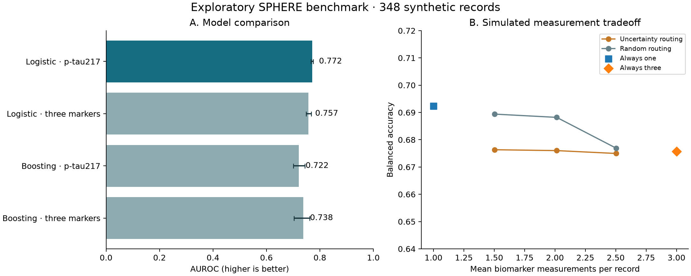

# SPHERE staged biomarker testing

An exploratory study of selective biomarker measurement for Alzheimer’s diagnostic-group classification using SPHERE synthetic data.

**Status:** completed internal research package, November 9, 2026. The repository contains reproducible analysis code, aggregate results, figures, and an internal-review archive. It is not a clinically validated tool or a peer-reviewed publication.

## Research question

Can selectively adding GFAP and NfL to p-tau217 improve classification of probable Alzheimer’s disease versus healthy controls while using fewer measurements than testing all three biomarkers for every record?

The study compares a one-biomarker reference, a full three-biomarker panel, and staged policies that request the extra two biomarkers when the first-stage prediction is near its decision threshold. Random acquisition policies provide a comparison at the same achieved measurement budget.

**Main finding:** p-tau217-only logistic regression achieved mean AUROC **0.772** across ten repeated five-fold evaluations. The tested staged policies did not improve the observed error–measurement tradeoff. Adding biomarkers improved the nonlinear comparator’s AUROC relative to its one-feature version, but neither nonlinear model surpassed the logistic reference. These findings are specific to the tested models and synthetic release; they do not establish that GFAP or NfL lack biological or clinical value.

## Start here

- [Final report](outputs/FINAL_REPORT.html): self-contained HTML with methods, results, figures, interpretation, and limitations. Download it and open it in a browser; GitHub may display the HTML source rather than render the report.
- [Study and model card](docs/model-card.md): intended use, endpoint, evidence, and known gaps.
- [Staged-testing results](outputs/staged_testing_report.md): measurement budgets and classification performance.
- [Internal-review package](SPHERE_Research_Package.zip): code, documentation, aggregate outputs, and a SHA-256 file manifest; excludes raw rows and individual predictions.



The left panel shows mean AUROC with minimum–maximum variation across repeated splits, not confidence intervals. The right panel shows mean balanced accuracy against biomarker measurement count; its vertical axis is restricted to highlight small differences.

## Data and classification endpoint

The locally authorized SPHERE export contains 644 demographics records and 618 targeted-biomarker records. All 618 biomarker IDs match demographics, and identifiers are unique within both tables.

| Analysis property | Definition |
|---|---|
| Included cohort | 348 synthetic records with matched demographics and biomarkers |
| Positive class | 73 records labeled `Probable Alzheimers Disease` |
| Negative class | 275 records labeled `Healthy Control` |
| Positive prevalence | Approximately 21.0% |
| Primary predictors | `PTAU217`, `GFAP`, and `NFL` |
| Excluded predictors | IDs, diagnosis-derived indicators, and cognitive scores |
| Excluded diagnostic groups | MCI, possible/mixed AD, other diagnoses, and unknown labels |

This is cross-sectional diagnostic-group classification. It does not predict future disease, evaluate a general screening population, or establish patient-level clinical performance.

Exported biomarker values are finite but include negatives. The analysis retains those signed values unchanged. Exact assay units, transformations, and finite missing-value codes remain unresolved, so results are conditional on treating the exported values as usable synthetic features. See the [initial audit](docs/initial-audit.md) and [questions for the data provider](docs/clarifications-needed.md).

## Evaluation design

### Models and splits

The reference is logistic regression with `C=1.0`, `max_iter=2000`, and standardization fitted inside each training fold. The nonlinear comparator is histogram gradient boosting with 100 iterations, learning rate 0.05, at most four leaves, minimum leaf size 20, L2 regularization 1, and early stopping disabled. There is no hyperparameter search.

The main comparisons use ten stratified five-fold repetitions with seeds `20261201` through `20261210`. Methods share outer splits. The initial baseline uses seed `20261108`; calibration and subgroup descriptions use the single prespecified split seed `20261201`.

For threshold-based experiments, four-fold predictions inside each outer training set select the largest threshold attaining at least 80% sensitivity on those inner predictions. The outer test labels do not select the threshold. The training sensitivity target is not guaranteed on held-out records.

### Staged measurement policies

1. Obtain a p-tau217-only score for every record.
2. Use distance from a training-selected decision threshold as a heuristic for uncertainty.
3. Set routing margins using the 25th, 50th, or 75th percentile of training-score distances.
4. For routed records, substitute the three-biomarker model’s score and count two additional measurements.
5. Select a final hybrid decision threshold using training predictions, then evaluate on the outer test fold.

The nominal routing percentage is defined on training predictions; the achieved test percentage can differ. Random comparators match the staged policy’s achieved acquisition count in each fold, without using test labels. Always-one and always-three policies provide endpoint references.

All biomarkers are already observed in the source data: the experiment simulates acquisition by hiding measurements. Measurement count is a resource proxy, not a validated estimate of dollars, visits, or clinical savings. Hybrid probabilities mix uncalibrated model scores.

### Additional analyses

The pipeline also includes single-feature and paired-feature ablations, post-hoc error transitions, descriptive correlations, calibration bins, age/sex subgroup summaries, an age/sex-only reference, and 25 label-shuffle sanity controls. These are exploratory analyses of the same release, not independent confirmation. The label-shuffle exercise is an engineering check, not a population-level inferential test.

## Results

### Fixed-model comparison

Values below are means across ten repeated five-fold evaluations. Higher AUROC and average precision are better; lower Brier score and log loss are better.

| Model | Biomarkers | AUROC | Average precision | Brier score | Log loss |
|---|---|---:|---:|---:|---:|
| Logistic regression | p-tau217 | 0.772 | 0.536 | 0.133 | 0.433 |
| Logistic regression | All three | 0.757 | 0.518 | 0.135 | 0.440 |
| Histogram gradient boosting | p-tau217 | 0.722 | 0.453 | 0.142 | 0.459 |
| Histogram gradient boosting | All three | 0.738 | 0.461 | 0.143 | 0.457 |

See the [nonlinear comparison report](outputs/nonlinear_report.md) for paired differences and the [feature-ablation report](outputs/incremental_value_report.md) for individual and paired panels.

### Staged testing

Balanced accuracy is the average of sensitivity and specificity. Each acquired panel adds GFAP and NfL to the initial p-tau217 measurement.

| Policy | Mean measurements | Extra panel acquired | Sensitivity | Specificity | Balanced accuracy |
|---|---:|---:|---:|---:|---:|
| Always p-tau217 only | 1.00 | 0.0% | 79.0% | 59.4% | 0.692 |
| Staged, 25% nominal | 1.50 | 25.1% | 78.9% | 56.4% | 0.676 |
| Random, matched to 25% policy | 1.50 | 25.1% | 79.6% | 58.3% | 0.689 |
| Staged, 50% nominal | 2.01 | 50.7% | 78.8% | 56.4% | 0.676 |
| Random, matched to 50% policy | 2.01 | 50.7% | 78.8% | 58.9% | 0.688 |
| Staged, 75% nominal | 2.50 | 75.1% | 78.6% | 56.4% | 0.675 |
| Random, matched to 75% policy | 2.50 | 75.1% | 78.8% | 56.6% | 0.677 |
| Always all three | 3.00 | 100.0% | 79.2% | 56.0% | 0.676 |

Uncertainty routing trailed its budget-matched random comparator on mean balanced accuracy at all three tested budgets. Moving from the standalone one-marker classifier to the three-marker classifier corrected an average of 7.0 errors but introduced 16.4 per repetition. Those transitions include both added features and changed decision thresholds; they are not causal biomarker effects. See the [error analysis](outputs/error_analysis_report.md).

The practical lesson for this experiment is that proximity to a decision boundary does not necessarily identify records that benefit from additional measurements. No deployment policy was selected.

## Reproduce locally

### Prerequisites

Use Python 3.13; development and verification used Python 3.13 on macOS. Other platforms have not been tested. Exact dependency versions are recorded in [requirements.txt](requirements.txt).

Obtain the official `ADRC_SPHERE_all_data.zip` archive through your own authorized Stanford access. The repository does not include the source archive, raw tables, or access credentials. Dependency installation needs network access; the analysis itself uses local files only.

### Setup and complete run

Run from the repository root:

```sh
git clone https://github.com/hamoonea/sphere-alzheimers.git
cd sphere-alzheimers
python3.13 -m venv .venv
.venv/bin/python -m pip install -r requirements.txt
.venv/bin/python scripts/prepare_data.py /path/to/ADRC_SPHERE_all_data.zip
.venv/bin/python scripts/run_all.py
```

The repository is private, so cloning requires an authorized GitHub account. Replace the archive path with your actual local path, quoting it if it contains spaces.

The preparation script expects exactly one root-level `demographics_diagnosis.csv` and one `biomarkers.csv` in the archive. It extracts only those tables into `data/raw/` and refuses to overwrite different existing data. The runner stops if any stage fails and regenerates aggregate outputs, figures, and the HTML report.

To check installed dependency compatibility, reconcile existing outputs, and rebuild the review archive:

```sh
.venv/bin/python -m pip check
.venv/bin/python scripts/verify_results.py
.venv/bin/python scripts/package_project.py
```

`verify_results.py` checks existing output files; it does not rerun models or independently re-audit the current raw files. Use `run_all.py` for a full reproduction from the local inputs. The packaging script requires a passing verification result and writes `SPHERE_Research_Package.zip` with a checksum manifest.

### Pipeline stages

| Script | Purpose |
|---|---|
| `prepare_data.py` | Extract the two required tables from an authorized archive |
| `audit_data.py` | Check table structure, unique IDs, joins, counts, and source hashes |
| `baseline.py` | Evaluate prevalence, one-marker, and three-marker baselines |
| `robustness.py` | Repeat paired splits and select decision thresholds within training data |
| `staged_testing.py` | Compare staged, random, and full/one-marker acquisition policies |
| `error_analysis.py` | Summarize corrected and introduced errors across repeated splits |
| `incremental_value.py` | Compare biomarker panels and describe correlations |
| `nonlinear_comparison.py` | Compare fixed logistic and gradient-boosting models |
| `final_checks.py` | Produce calibration, subgroup, demographic-reference, and shuffle checks |
| `verify_results.py` | Reconcile cross-experiment outputs and evaluation invariants |
| `build_report.py` | Generate the self-contained HTML report and figures |
| `run_all.py` | Execute the analysis stages in order, stopping on failures |
| `package_project.py` | Build the allowlisted internal-review archive |

### Verification coverage

The nine reconciliation checks cover source-hash agreement, cohort counts, cross-experiment baseline equality, staged/random measurement budgets, acquisition endpoints, error-transition reconciliation, calibration denominators, subgroup denominators, and negative-control count. Individual analysis scripts also assert training/test separation and other local invariants.

Passing these checks supports implementation consistency. It does not resolve assay semantics, establish clinical validity, or eliminate dependence introduced by synthetic-data generation.

### Common setup issues

- **Missing input files:** run `prepare_data.py` with the authorized archive before running the analysis.
- **Archive layout rejected:** confirm that the archive contains the two expected root-level filenames; the extractor does not search nested folders or guess alternative tables.
- **Existing data differs:** inspect the source release before replacing local inputs. The refusal protects against silently mixing datasets.
- **Dependency installation fails:** confirm the Python version and consult the exact pins. If reproducing with a different environment, record the change and revalidate the results.
- **Verification fails:** inspect the failed assertion and rerun the full pipeline to avoid combining outputs from different runs. Do not bypass assertions to produce a review package.

## Repository structure

```text
sphere-alzheimers/
├── README.md
├── requirements.txt
├── scripts/                         # Analysis, verification, and packaging
├── docs/                            # Study designs, audit notes, limitations
├── outputs/
│   ├── FINAL_REPORT.html            # Self-contained narrative report
│   ├── *_metrics.json              # Machine-readable aggregate results
│   ├── *_report.md                 # Experiment reports
│   ├── initial_audit.json
│   ├── final_checks.json
│   ├── verification.json
│   └── figures/                     # PNG and SVG figures
├── publication/                     # Release description and unsent review draft
├── SPHERE_Research_Package.zip      # Internal-review archive with manifest
└── data/raw/                        # Local authorized inputs; not tracked
```

Raw tables, `outputs/local_oof_predictions.csv`, execution logs, credentials, virtual environments, and caches remain local and are excluded from version control. Aggregate JSON/Markdown outputs, the HTML report, and figures are tracked. The archive uses an explicit allowlist and excludes raw tables and record-level predictions; publication drafts are maintained separately in `publication/`.

## Limitations and next steps

The release is jointly synthesized, so ordinary row-level cross-validation cannot demonstrate generalization to independent real patients. Repeated splits reuse the same records, and successive experiments were informed by earlier findings. Split ranges are descriptive, not confidence intervals, and there is no untouched confirmatory cohort.

The narrow probable-AD-versus-control endpoint excludes difficult diagnostic groups. Assay units and finite missing codes remain incompletely confirmed. Simulated acquisition does not address real missing-data workflows, actual costs, or patient outcomes. Models and routing heuristics cover a limited design space; subgroup summaries are descriptive and do not establish fairness.

The completed contribution is a reproducible exploratory benchmark and a documented negative result. It does not establish an optimal model, research novelty, clinical efficacy, economic benefit, or a deployable diagnostic system.

Next steps are to clarify feature semantics, freeze a validation design, and evaluate an independently authorized cohort with compatible assays and labels. [The external-validation plan](docs/external-validation.md) identifies ADNI as a possible future source; no ADNI access application or validation has been performed. Any future benefit-aware acquisition policy would require training-only benefit labels and an additional nested evaluation layer.

## Data governance and publication status

This package and its private GitHub repository are for internal review. The project’s recorded Stanford agreement includes restrictions on redistribution and review requirements before public disclosure of results. The accepted agreement governs use and sharing; a private repository is not a substitute for compliance with those terms.

Public release remains pending documentation that the applicable pre-disclosure review requirement has been satisfied. The [release description](publication/RELEASE_DESCRIPTION.md) is preparatory, and the [Stanford review request](publication/STANFORD_REVIEW_REQUEST_DRAFT.md) is an unsent draft. No DOI, publication acceptance, or peer review is claimed. No raw SPHERE data or credentials should be committed or added to the review archive.

## Acknowledgment and source references

Stanford Alzheimer’s Disease Research Center, NIH/NIA grant **P30 AG066515**.

- [SPHERE portal](https://adrc-sphere.stanford.edu/)
- [SPHERE methods paper linked in the project documentation](https://pmc.ncbi.nlm.nih.gov/articles/PMC13596149/)
- [Access and evidence notes](docs/access-and-evidence.md)
- [Evaluation protocol](docs/protocol.md)
- [Staged-testing design](docs/staged-testing-design.md)

The protocol and early audit notes preserve the study’s planning history. Use this README, the final report, and the model card for the completed study’s current scope.
